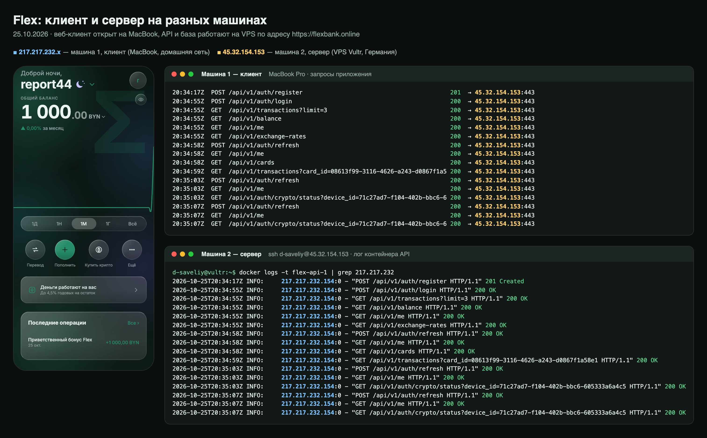
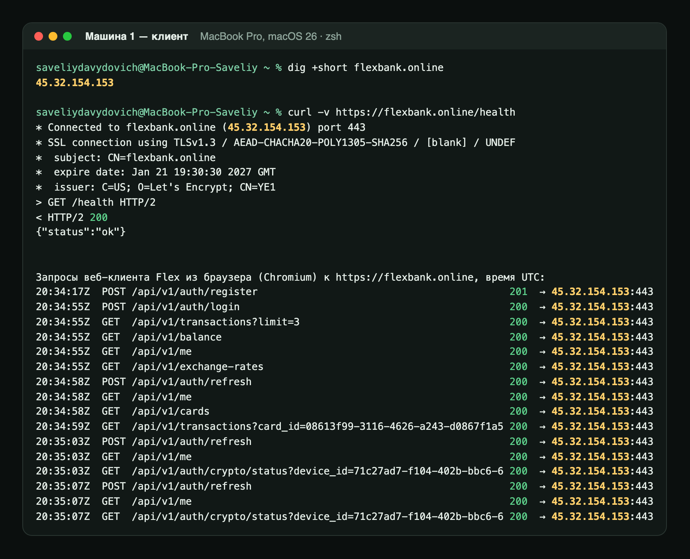
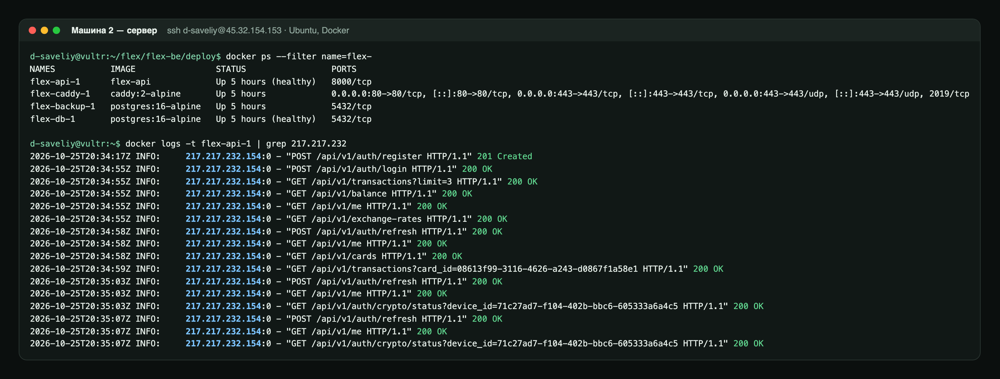
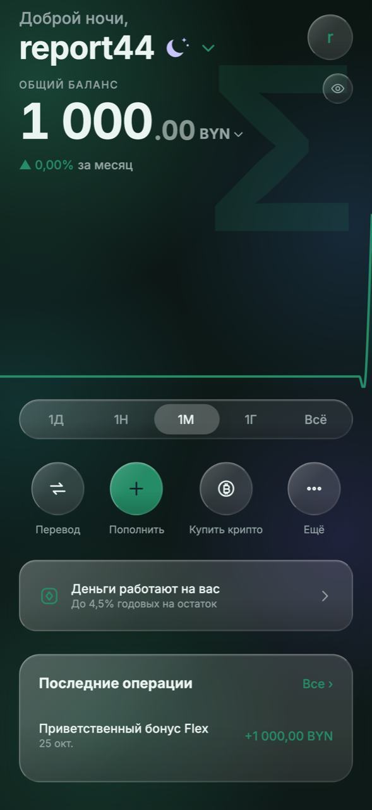
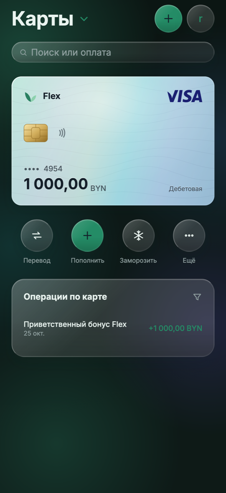
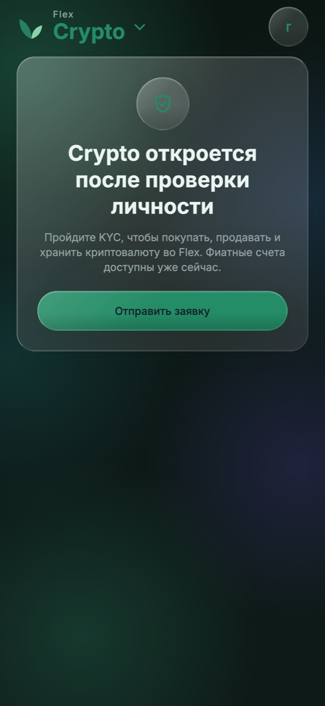

# Flex — мобильное приложение

Клиентская часть **Flex** — мобильного криптобанка, который объединяет классический банкинг и операции с криптовалютой в одном приложении. Написано на React (React Native + Expo) и работает на iOS, Android и в браузере из одной кодовой базы.

Серверная часть — репозиторий [flex-be](https://github.com/dsaveliy/flex-be): FastAPI + PostgreSQL. API описан в [flex-be/docs/api.md](https://github.com/dsaveliy/flex-be/blob/main/docs/api.md), развёртывание — в [flex-be/docs/deploy.md](https://github.com/dsaveliy/flex-be/blob/main/docs/deploy.md).

**Рабочая версия:** [https://flexbank.online](https://flexbank.online) · документация API (Swagger): [https://flexbank.online/api/v1/docs](https://flexbank.online/api/v1/docs)

---

## 1. Экраны

| Экран | Что на нём |
|---|---|
| **Вход и регистрация** | вход по телефону или email; регистрация с подтверждением почты одноразовым кодом |
| **Главная** | общий баланс в выбранной валюте, график за 1Д/1Н/1М/1Г/всё, быстрые действия, предложение, последние операции |
| **Карты** | карусель карт, реквизиты на обороте, заморозка, выпуск новой карты, операции по карте с фильтром |
| **Crypto** | закрыт до KYC и PIN-кода (второй уровень защиты); рабочий стол из виджетов (курсы, портфель, лидеры роста, новости, индекс страха и жадности, обмен) с редактированием как на iPhone; разделы «Курсы», «Новости», Trade, Convert, «Фиат», «Портфель», Earn |
| **Профиль** | данные пользователя, тема, язык, скрытие баланса, безопасность раздела Crypto (PIN, Face ID) |
| **Операции** (шторки) | перевод клиенту Flex по номеру телефона, пополнение с привязанной тестовой карты, вывод на неё, обмен валют, оплата по QR (эмулятор терминала с кэшбэком), покупка и продажа крипты (Trade, Convert), подключение Earn, выпуск виртуальной карты и заморозка |

Курсы криптовалют (CoinGecko), официальные курсы НБРБ, индекс страха и жадности и новости (RSS ForkLog и Bits.media) настоящие: их собирает сервер. Деньги виртуальные — это записи в базе сервера. Новый клиент получает 1000 BYN приветственного бонуса.

---

## 2. Технологии

* **React 19 + React Native 0.86**, **Expo SDK 57** — одна кодовая база для iOS, Android и веба (react-native-web)
* **TypeScript** (strict)
* **Expo Router** — файловая маршрутизация (`app/`)
* **TanStack Query** — запросы, кэш, фоновое обновление курсов
* **Reanimated + Gesture Handler** — анимации и жесты (перетаскивание виджетов, переворот карты)
* **expo-glass-effect, @expo/ui** — нативное «жидкое стекло» и системные меню iOS
* **expo-secure-store, expo-local-authentication** — refresh-токен в Keychain, вход в Crypto по Face ID
* **i18next** — русский и английский

---

## 3. Структура

```text
app/                      экраны (Expo Router)
├── (auth)/               вход, регистрация, подтверждение кода
├── (tabs)/               Главная, Crypto, Карты
├── account.tsx           профиль
└── widget-gallery.tsx    галерея виджетов Crypto
src/
├── api/                  контракт API, HTTP-клиент, mock-реализация, хуки React Query
├── auth/                 сессия, токены, обновление, PIN и биометрия
├── features/             компоненты экранов: home, cards, crypto, auth
├── ui/                   дизайн-система: стекло, кнопки, поля, графики, иконки
├── theme/, i18n/, providers/, utils/
docs/                     контракты экранов и аутентификации
```

---

## 4. Запуск

```bash
npm install
cp .env.example .env      # указать адрес сервера (или оставить пустым — будут mock-данные)
npx expo start            # i — iOS, a — Android, w — браузер
```

| Режим | `EXPO_PUBLIC_API_URL` в `.env` |
|---|---|
| mock-данные, без сервера | не задан (или `EXPO_PUBLIC_USE_MOCK=1`) |
| боевой сервер | `https://flexbank.online/api/v1` |
| сервер на компьютере в той же Wi-Fi сети | `http://<IP компьютера>:8000/api/v1` |

После изменения `.env` перезапустите Metro с `--clear`: значение подставляется при сборке.

Сборки для пользователей:
- **веб** — `npx expo export --platform web`; на сервере собирается автоматически (`Dockerfile`);
- **Android APK** — `npx eas-cli build -p android --profile preview` (профили в `eas.json`).

Подробнее — [flex-be/docs/deploy.md](https://github.com/dsaveliy/flex-be/blob/main/docs/deploy.md), §6.

Проверки: `npm run typecheck`.

---

## 5. Сетевое взаимодействие клиента и сервера

Клиент и сервер работают на разных физических машинах и общаются через интернет:

- **клиент** — приложение на телефоне, веб-версия в браузере или Expo на компьютере разработчика;
- **сервер** — арендованная виртуальная машина (VPS Vultr, Германия, IP `45.32.154.153`), Ubuntu + Docker, домен `flexbank.online`.

Для разработки фронтенда сервер разворачивать не нужно: достаточно указать его адрес в `.env`.

### 5.1. Выбранный способ и почему

Для взаимодействия мы используем **публичный сервер с доменным именем и HTTPS**. Сервер доступен из любой сети по адресу `https://flexbank.online`, на устройство клиента ничего ставить не нужно.

Мы рассмотрели VPN-сети (Hamachi, Radmin VPN, Tailscale) и туннели (ngrok, cloudflared). Выбрали VPS, потому что:

| Требование | VPN (Hamachi, Radmin, Tailscale) | Туннель (ngrok, cloudflared) | VPS + домен |
|---|---|---|---|
| Работает, когда компьютер разработчика выключен | нет | нет | **да** |
| Ничего не ставить на телефон или компьютер клиента | нет, нужен клиент VPN | да | **да** |
| Постоянный адрес | да | только платно или со своим доменом | **да** |
| HTTPS (iOS не пускает приложения по HTTP) | нет | да | **да** |
| Подходит для реальных пользователей | нет | ограниченно | **да** |

### 5.2. Как это работает

```
 Машина 1: клиент                                 Машина 2: сервер (VPS)
┌──────────────────────┐                      ┌──────────────────────────────────────────┐
│ приложение Flex      │   1. DNS: домен → IP │  Docker                                   │
│  fetch("https://flex │ ───────────────────► │ ┌────────┐  /api/*  ┌─────┐   ┌──────────┐ │
│  bank.online/api/…") │   2. TCP :443        │ │ Caddy  │ ───────► │ API │──►│PostgreSQL│ │
│                      │   3. TLS-рукопожатие │ │ :80    │          │:8000│   │  :5432   │ │
│                      │ ◄──────────────────► │ │ :443   │ ─► веб-  └─────┘   └──────────┘ │
│                      │   4. HTTP/JSON       │ └────────┘   версия    внутренняя сеть     │
└──────────────────────┘                      └──────────────────────────────────────────┘
                                                 firewall: открыты только 22, 80, 443
```

1. **DNS.** Приложение знает только имя сервера. DNS-резолвер по A-записи домена получает IP-адрес VPS. Поэтому при переезде на другой сервер достаточно поменять одну запись DNS, приложение пересобирать не нужно.
2. **TCP и порты.** Клиент открывает TCP-соединение на порт 443 сервера. Firewall на сервере (ufw) пропускает только 22 (SSH), 80 и 443, остальные порты закрыты.
3. **TLS (HTTPS).** Сервер предъявляет сертификат, подписанный Let's Encrypt. Клиент проверяет, что сертификат выдан именно на этот домен, и договаривается с сервером о ключе шифрования. Всё дальнейшее, включая пароли и токены, передаётся зашифрованным. Сертификат Caddy получает сам по протоколу ACME: Let's Encrypt проверяет владение доменом через порт 80 и выдаёт сертификат на 90 дней, Caddy продлевает его автоматически.
4. **Обратный прокси (reverse proxy).** Caddy — единственная программа, которая принимает соединения из интернета. По пути запроса он решает, куда его передать: `/api/*` — контейнеру с API, остальное — файлам веб-версии. Реальный IP клиента Caddy передаёт в заголовке `X-Forwarded-For`, на нём держатся лимиты попыток входа.
5. **Внутренняя сеть Docker.** Caddy, API и PostgreSQL работают в отдельных контейнерах с общей виртуальной сетью и находят друг друга по именам (`api`, `db`). У базы нет опубликованных портов, поэтому из интернета она недоступна.
6. **Прикладной уровень.** Обмен идёт по REST: JSON в теле, токен доступа JWT в заголовке `Authorization: Bearer …`. Если токен истёк, клиент обновляет его refresh-токеном и повторяет запрос (`src/api/authInterceptor.ts`). Веб-версия загружается с того же домена, что и API, поэтому браузер не применяет ограничения CORS.

### 5.3. Как подключиться к серверу

1. Сервер разворачивается по инструкции [flex-be/docs/deploy.md](https://github.com/dsaveliy/flex-be/blob/main/docs/deploy.md) (конфигурация — в [flex-be/deploy/](https://github.com/dsaveliy/flex-be/blob/main/deploy)). Проверка, что он отвечает:
   ```bash
   curl https://flexbank.online/health          # {"status":"ok"}
   ```
2. На машине разработчика фронтенда в `.env` укажите адрес сервера:
   ```bash
   EXPO_PUBLIC_API_URL=https://flexbank.online/api/v1
   ```
3. Запустите приложение (`npx expo start --clear`) и зарегистрируйтесь. Пока на сервере не настроена отправка писем, аккаунт создаётся сразу, без кода из письма.

Без установки приложения: откройте [https://flexbank.online](https://flexbank.online) в браузере телефона или компьютера.

**Доступность сервера (договорённость в команде).** Сервер работает круглосуточно, компьютер разработчика для этого включать не нужно. Обновления выкатываются скриптом `deploy.sh` (несколько секунд простоя), о плановых работах договариваемся в чате команды.

### 5.4. Вариант для разработки в одной Wi-Fi сети

Если сервер запущен на соседнем компьютере в той же сети:
- бэкенд запускается с `uvicorn app.main:app --host 0.0.0.0`, чтобы слушать все сетевые интерфейсы, а не только `localhost`;
- в `.env` указывается `http://<IP компьютера>:8000/api/v1` (IP: `ipconfig getifaddr en0` на macOS, `hostname -I` на Linux);
- брандмауэр компьютера с сервером должен разрешать входящие соединения на порт 8000.

HTTP без шифрования iOS разрешает только для локальной сети, поэтому этот вариант подходит лишь для разработки.

### 5.5. Подтверждение работы

Проверка 25.10.2026: на MacBook (машина 1, домашняя сеть, внешний IP `217.217.232.x`) открыта веб-версия `https://flexbank.online`. В ней зарегистрирован новый пользователь, затем выполнен вход и открыты экраны «Главная», «Карты» и «Crypto». Все данные на экранах пришли с VPS (машина 2, `45.32.154.153`).



Слева — экран приложения на клиенте. Справа сверху — запросы клиента: все уходят на `45.32.154.153:443`. Справа снизу — лог API на сервере: те же запросы в то же время (UTC) пришли с IP клиента `217.217.232.154`.

**Машина 1 — клиент.** DNS превращает `flexbank.online` в IP сервера, TLS-сертификат от Let's Encrypt выдан на этот домен, сервер отвечает `{"status":"ok"}`:



**Машина 2 — сервер.** Контейнеры Caddy, API и PostgreSQL. Наружу открыты только порты 80 и 443 у Caddy; в логе API — запросы с IP клиента:



**Экраны клиента с данными сервера:** баланс и приветственный бонус, карта, проверка доступа к Crypto (`/auth/crypto/status`).

| Главная | Карты | Crypto |
|---|---|---|
|  |  |  |
